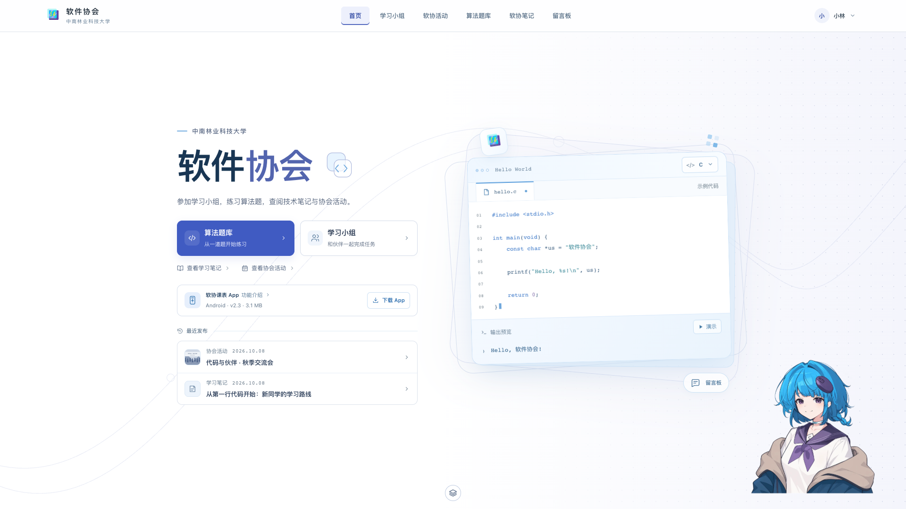
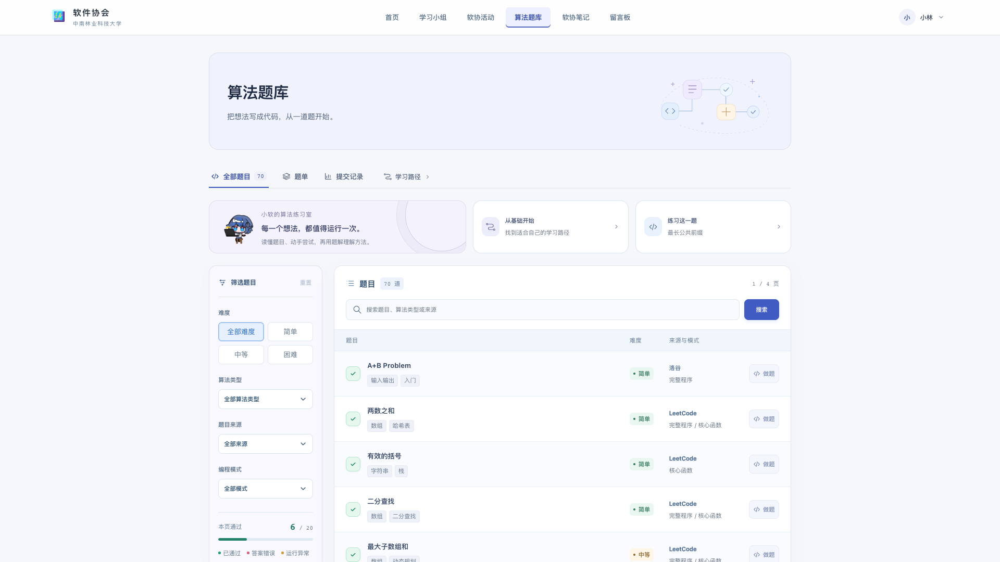
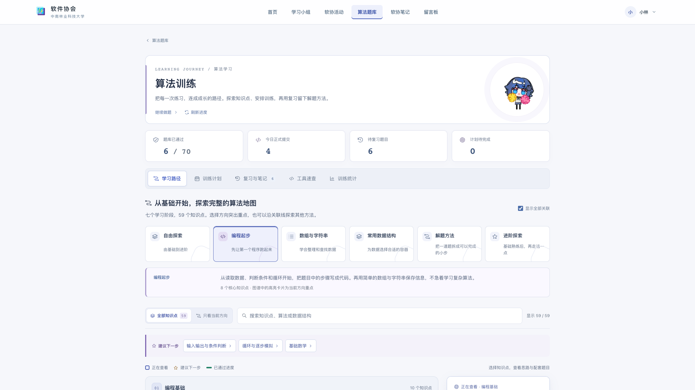
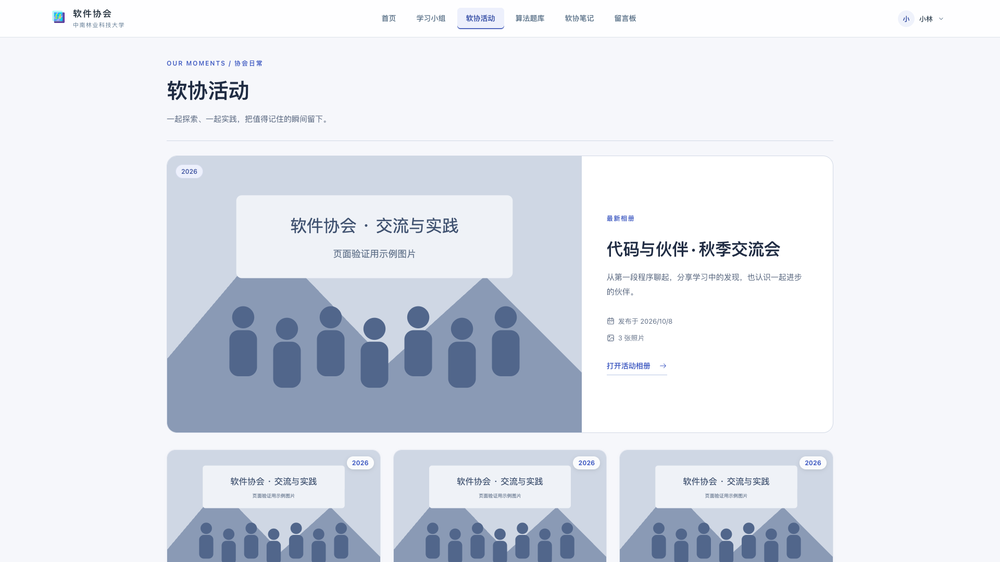
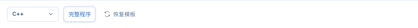
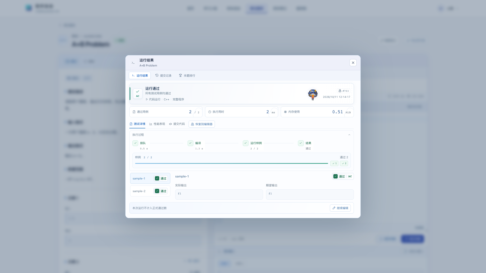
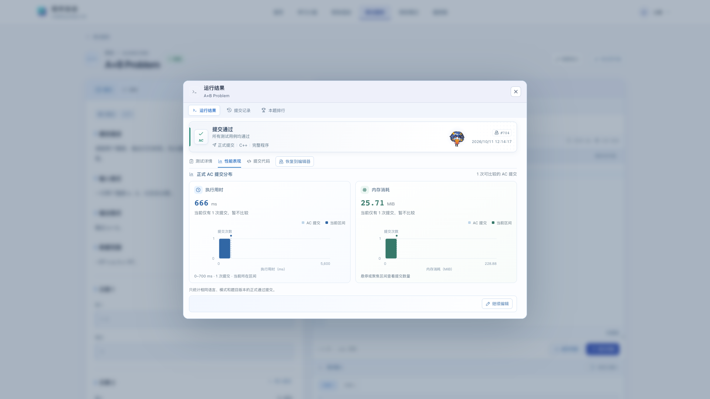

# 小软主题与素材处理

首页使用用户提供的人物截图作为编辑目标，通过内置 imagegen 进行透明背景提取。人物的蓝色头发、紫色发饰、眼睛和服装保留，海报文字、色块、故障条纹、几何线和图片查看器界面移除。最终网站资产为 `sap-user/src/assets/xiaoruan/hero-480.webp` 与 `hero-960.webp`，保留透明通道；手机版约 46 KiB，桌面版约 122 KiB。网页标题、链接、代码卡片和装饰线由 HTML、CSS 与 SVG 渲染。



## 全用户端的排版与交互

用户端全部路由使用同一套文字、间距、表单与状态规范。暖白承载正文，深蓝灰用于标题与阅读，蓝紫用于主操作和当前选中项。AC 保留绿色，错误使用红色，警告使用琥珀色，避免把整块内容涂成状态色。页面中的英文标签为辅助信息，主要信息与操作使用中文。

首页保留完整桌面首屏和代码卡片的浮动、标志与像素动画。人物安排在首屏右下角的留白区，适当放大并展示完整上半身，与标题、代码窗口和按钮分开；较矮桌面屏幕缩小人物并收紧代码区，代码内容可以在卡片内滚动。手机按内容顺序排列。桌面字体与页面宽度同时按可用宽度、高度调整，并保留可读字号下限，避免 1080p 过满或 4K 只放大文字。

活动页采用照片与文字的明确分栏，相册支持缩略图、键盘和关闭操作。学习小组统一任务、个人成绩和统计页面；笔记区增强阅读宽度、段落与浅色代码高亮，搜索结果为空时提供恢复入口。留言板区分发言、回复与游客提示。个人资料、入会、登录、注册与找回密码统一表单层级，字段标签与输入框明确关联。App 介绍页保留独立入口与整屏展示，三种课表模式、功能截图和放大预览使用一致的选中与焦点样式。

题库涵盖题目目录、题单、提交统计、做题工作台、五语言题解，以及结果、历史与排行弹窗。弹窗尺寸固定，切换内容使用已有缓存。学习路径保留七阶段完整图谱，蓝紫表示当前查看，金色星标表示推荐，绿色细进度条表示已通过题目，并突出与当前节点有关的连接。训练计划、复习笔记、工具速查和统计页面同步调整。

首页人物在标准 1080p、2K、4K 视口下的宽度分别为 270、360、540 px，较 1.5.47 放大 80%。较窄或较矮的桌面缩小人物并调整底部距离，手机使用顺序排列，避开代码区、演示按钮和留言入口。人物素材沿用已有 WebP，没有新增图片体积。

标准 16:9 桌面下，常规内容区保持相同占屏比例；双栏做题工作台采用更宽的画布。首页继续覆盖导航下的完整首屏，较矮或较窄视口使用紧凑布局。

| 视口 | 根字号 | 常规页面宽度 | 做题工作台宽度 | 学习页动画宽度 |
| --- | ---: | ---: | ---: | ---: |
| 1920 × 1080 | 15 px | 1170 px | 1560 px | 120 px |
| 2560 × 1440 | 20 px | 1560 px | 2080 px | 160 px |
| 3840 × 2160 | 30 px | 2340 px | 3120 px | 240 px |

题库目录的三个内容页签使用文字与底线标识当前页，学习路径作为独立路由入口放在同一行，取消单独的紫色块。学习页的自动播放动画适当放大，辅助圆环与标题留白同步调整，手机仅显示简短的中文辅助标题。








本轮以模拟账户验证全部 17 个路由，在 320px、390px、768px、1280px、1920px、2560px、3840px 的视口检查页面布局，并检查主要页签、弹窗、加载失败恢复和游客状态。测试过程不创建真实下载票据、不发送消息、不提交判题。

结果弹窗收紧标题、导航、统计和执行过程的留白，桌面固定为 62rem × 43rem，结果、记录与排行之间切换时尺寸保持一致。通过用例、用时与内存统计使用紧凑横排；展开样例执行过程后，常规两组样例的输出与继续编辑按钮仍可在一屏内显示。较长输出与较多记录保留内部滚动，手机按可用宽度排列。

语言选择器收起时只显示当前语言名称，打开后展示五种语言与编译器版本详情。排队与运行状态使用短标签，避免英文状态超出方块。通过时的欢乐动画安排在顶部结果区域，沿用按需加载的动画 WebP；错误、排队与运行状态不显示庆祝动画。





性能页压缩统计与图表的高度，保留时间、内存分布、当前区间和键盘聚焦查询。1080p、2K、4K 标准桌面的弹窗宽度均占视口约 48.44%，高度约 59.72%。9 种视口的 99 组状态检查及两条真实通过记录的 24 组数据预览检查通过，桌面常规结果与性能页没有外层滚动；不创建真实判题提交。



题库的插画与图标使用 SVG，配色以蓝、紫、暖白为主。AC 继续保留绿色语义。原首页整屏布局和代码卡片的浮动动画保留。

表情选自用户提供的“小软表情包.zip”：加油、点赞、记录、问号、工作与礼物，共六个动作。GIF 转为 192px 动画 WebP，按原循环时长采样，播放无需点击。进入视口才请求对应动画；离开视口或后台标签页时停止渲染，减少动画与节省流量设置下使用静态 WebP。资源随前端发布，使用带哈希文件名和 30 天 immutable 缓存，没有新增对象存储费用。整包原 GIF 未纳入网站。

学习路径使用五个面向初学者的方向：编程起步、数组与字符串、常用数据结构、解题方法、进阶探索。默认展示七个阶段、59 个知识点的完整地图，当前学习方向突出重点，新账户的编程起步方向推荐 8 个基础概念。支持搜索与只看当前方向，筛选时保留前置知识。旧方向读取时映射为新方向，已有计划、收藏、笔记与复习记录保留。

使用内置 imagegen，最终提示词如下：

```text
Use case: background-extraction.
Asset type: transparent mascot illustration for the first screen of the software association website.
Input image: the supplied poster screenshot is the edit target. Extract ONLY the large anime girl, preserving her original identity, pose, face, proportions, and illustration style. Keep cyan-blue bobbed hair with the side braid, violet round hair ornament, purple eyes, white sailor shirt with navy-purple collar and bow, and oversized beige and deep-blue coat exactly as in the reference. Preserve the existing waist-up framing with the head and coat completely within the output, extend just the tiny cropped coat edges naturally if necessary.
Primary request: remove the entire poster background, ALL words, typography, logos, rectangles, glitch bars crossing the girl, geometric lines, globe, barcodes, and the black image-viewer bars. Cleanly reconstruct small parts of the girl's hair or clothing hidden by decorative glitch strips. Center the isolated character in a portrait canvas with small transparent margins. Actual transparent alpha background, crisp clean edges. No added props, no added decoration, no new text, no frame, no shadows behind the character, no checkerboard baked into the image. This is a faithful cutout/edit, not a redesign.
```
