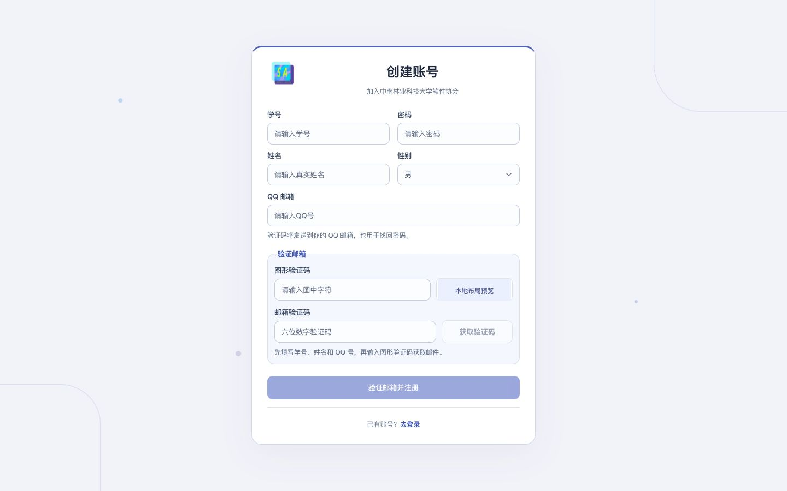

# SAP2026 安全复审处置说明（2026-10-18）

本文件对应 `review-2026-10-18.md`。原报告保留，处置依据为实际代码、隔离测试与部署检查。下表区分真实缺陷、业务/部署边界、误报及外部条件，不能把“未修改”都理解为“没有风险”。

## 已修复的实际问题

| 原编号 | 处理方案 |
|---|---|
| C1 | 普通管理员不能修改角色 0/1 的资料或恢复邮箱；不能禁用自己。恢复邮箱改变或禁用账号后，在事务提交后撤销该账号会话。0/1 仍按既有产品规则视为同级。 |
| C2 | 通用配置读取改为逐项白名单，同时复验 MySQL 实际命中行。COS、SMTP、注册防护、下载直链等配置不能通过大小写、重音、尾空格或任意 key 读取。 |
| C3 | 邮件配置、模板、绑定、测试发送和投递详情统一只允许 0/1；菜单同步。验证码禁止出现在 HTML 属性、URL、图片地址和样式内容中，防止模板外带验证码。保留管理员配置合法 SMTP 服务商的能力。 |
| C4 / H4 | 原创题也必须校验非空来源链接，仅允许合法 HTTPS；用户端再做协议校验。已有恶意地址不会生成可点击链接。独立题库同步修复。H4 是 C4 的组合影响，不另算一条独立漏洞。 |
| H1 | 管理员重置密码后，在数据库事务提交后踢出全部旧会话，包含 App。正常 App 长期登录仍保留。 |
| H2 | 笔记 PDF、账单导出不再把令牌放 URL；用请求头鉴权、Blob 下载。作业下载通过带鉴权头的接口获取经校验的位置，文件仍由对象存储传输。后端禁用 query/body 与 cookie 取 token；Nginx 日志不记录 query 与完整 Referer。App 重定向到对象存储时剥离登录头。 |
| H5 | 在 JSON 解析前限制登录、注册、找回密码和节点心跳到 16 KiB，覆盖未知 Content-Length/chunked；Nginx 同步设置该上限。普通上传与个人资料不受此小体积上限影响。 |
| M1 | PDF 下载及下载计数都校验正式成员权限，游客无法绕过详情限制取到全文。 |
| M2 | 学习活动详情、周期、成员、负责人及评分总览至少要求正式成员。成员之间按原有学习协作设计查看进度，不改为私人单人页面。 |
| M3 | 审计统一使用 IpUtil，仅相信配置的代理和正确的真实 IP 头，不再直接取 XFF 第一段。 |
| M4 | 登录失败键对大小写、重音、首尾空白归一化；增加登录字段长度限制、失败记录容量与过期清理。 |
| M5 | Sa-Token 仅使用请求头，CORS 不允许浏览器自动携带凭据。可配置的跨域来源继续保留，方便自部署。 |
| M6 | 保留游客头像和反馈截图功能；游客上传限 2 MiB 图片，校验扩展名及文件头，不能上传任意文档。邮箱验证、已有上传配额继续生效。 |
| M7 | 下载目标仅允许本系统 Bucket/CDN 主机；拒绝其他 myqcloud 桶、用户信息和非 HTTPS 目标；代理流在读取过程中累计计数，未知长度同样不能超过 30 MiB。 |
| M8 | Nginx 在转发和后端审计之前增加 API 洪泛限流，超限请求在入口返回 429；保留正常请求的审计与业务活跃统计。 |
| M9 | 新增 CSP；在静态资源 location 显式补齐安全头，避免 add_header 继承失效。保留代码高亮、WASM、Worker 与既有动画所需能力。 |
| M12 | 根 Docker 上下文排除 secrets、pyc 和 __pycache__；管理端构建前清理 public 中的 Python 字节码，发布镜像也清理历史副本。独立工程本来已排除 secrets，继续保留。 |
| M13 / M23 | 独立工程的新初始化器与两种 Compose 默认仅绑定 127.0.0.1；拒绝示例管理员占位密码。未擅自覆盖用户已有私有 .env，单凭该文件 bind=0.0.0.0 不能断言已有服务绕过了外部防火墙/HTTPS 代理。 |
| M14 | App 下载必须有合法 SHA-256，缺失即停止；下载后检查哈希、包名、版本和与已安装应用一致的签名；安装前再次复验。Android 系统安装器本来已阻止不同签名覆盖安装，本次增加前置检查和清晰失败提示。 |
| M15 | App 教务 WebView 限定学校 HTTPS 地址，禁用混合内容、文件与内容访问、第三方 Cookie；去掉原生 JS bridge，改为 App 主动获取受信页面 HTML。同时兼容学校 HTTP/80 与 HTTPS/443 两种 WebVPN 代理地址的安全升级。 |
| M16 | 用户端笔记及管理端预览显式禁止表单、输入控件、style 等标签/属性，同时保留 Markdown、代码高亮与正常图文。 |
| M17 | 小程序退出调用服务端注销，随后清除平台身份、当前教务账号、课表和成绩缓存；鉴权失效也清除缓存。请求封装拒绝绝对 URL，防止把本站 token 发往其他站点。 |
| M18 | 默认、空、过短或重复单字符 AES 密钥只允许显式 dev/local/test 环境；未声明环境也不能以弱密钥运行。线上现有强密钥原值保留，防止存量教务凭据无法解密。 |
| M19 | 学校登录增加跨 App 用户的学校账号级硬限额和全局速率闸；保留正常 OCR 和官方 CAS 验证码字段协议，删除验证码和完整账号的调试输出。 |
| M22 | 独立工程的会话 lookup_key 和 payload 使用独立私有文件密钥做 AES-GCM 加密，密文绑定记录与类型；旧数据无损迁移，数据库不再保存直接可复用的令牌。 |

## 网页注册的必选邮箱验证

图形验证码、邮箱验证码在进入注册页时就显示，填写账户前也可见；桌面使用紧凑双列，手机切为单列。先完成图形验证码才可申请邮件，界面提供发送状态、180 秒重发倒计时、目标邮箱与错误反馈。修改学号或 QQ 后清除当前邮箱挑战，防止验证结果用于另一账号。

`POST /api/auth/register` 与 App 共用服务端一次性挑战，不接受旧版无邮箱验证码的注册协议。验证码为六位数字、15 分钟有效、最多五次校验尝试；数据库只存 HMAC。正确验证码的消费与用户创建在同一事务内完成，重复提交不能创建第二个账户；发送端另有账户、邮箱、IP 和全局限额。没有完成验证时，注册按钮不可用，直接调用接口同样拒绝。

布局预览（验证码图片为本地占位，没有向真实邮箱发送邮件）：

[移动布局预览](../../docs/screenshots/register-email-verification-mobile-preview.jpg)。上线后的 API 已另外验收；最终线上浏览器截图因 Mac 锁屏导致浏览器控制不可用，未将预览冒充线上截图。

## 低风险项与补充加固

- 角色编码限定 0–4；仍允许已授权的会长管理角色 0，符合原有 0/1 等价规则，不采纳“强行取消同级权限”的建议。
- 游客成员名册保留公开姓名/身份，隐藏学号和用户 ID；分页设置上限并避免整数溢出。
- 管理端附件链接前后端均校验 HTTPS，不能执行 javascript URL；下载也同步适配仅请求头鉴权。
- 登录失败记录、有待验证登录、教务会话有清理/容量限制；按账号增长的锁改为固定数量的条带锁。
- 教务抓取的跳转、表单 action 和请求目标按配置源站校验；MFA 外部地址限学校 HTTPS 域名，拒绝任意外站。个人教务会话即使缓存命中仍验证绑定归属；管理员采集的短信续登使用任务自己的临时会话，不放入个人会话缓存。
- 教务绑定、验证码、评教字段增加长度限制，日志不记录隐藏表单值；节点密钥必须是 64 位十六进制，创建即 0600，异常文件不能派生已知空密钥。
- App 禁止系统数据备份；桌面组件接收器不向其他普通应用导出；可分发构建缺正式证书时不能静默改用 debug 签名。
- 移除 Google Fonts 加载请求；本地判题检查脚本不再有硬编码登录口令。

## 不按原建议修改的项目及原因

| 原编号/建议 | 判断与保留原因 |
|---|---|
| H3：删除单容器内置判题能力 | 共享宿主内核和判题协调器的权限是实际部署边界，不能宣称已消除。但用户明确要求保留单 Docker 集成版，不能直接删掉。Java、Redis、OCR 已在所有模式下降权并清空 capabilities；分离部署仍提供，执行不可信代码建议使用独立主机/虚拟机。 |
| H6：给节点结果签名即可消除不可信节点 | 注册的执行节点本来就必须看到待执行代码和输入，HMAC/签名不能证明被攻陷节点诚实执行。节点管理已收紧到 0/1；保留受信执行器模型，不伪造“增加签名就实现可信计算”的安全保证。 |
| H7：立即轮换全部密钥、删除所有本地配置 | 报告确认未进入 Git/镜像/发布包，没有确认当前密钥被盗。SSH 私钥已移到仓库外 0700/0600 的身份目录，运维 Markdown 去掉原文；数据库/密钥配置继续以 0600 私有环境文件保存并忽略。强行更换 JW_AES_KEY 会破坏全部存量教务凭据，不做无证据破坏性轮换。 |
| M11：当前版本受 CVE-2024-22262 影响 | 这一具体指控不成立：[Spring 官方公告](https://spring.io/security/cve-2024-22262) 的受影响范围是 6.1.0–6.1.5，6.1.6 已修复。Boot 3.2 已过 OSS 支持的判断成立；升级到当前支持的大版本涉及 Spring/Jackson/MyBatis 等兼容迁移，未混在本次紧急修复中盲升，仍需要单独安排升级，不能把“此 CVE 误报”等同于“依赖永远安全”。 |
| M20：把学校全部 HTTP 回调字符串改成 HTTPS | 学校 CAS 注册的 service、WebVPN 代理别名与实际网络协议不是一回事，直接改字符串会破坏 SSO。保留官方注册回调与兼容直连回退，优先 HTTPS WebVPN，并保留会话自动升级到学校 HTTPS 源站的能力；直连 HTTP 的剩余传输风险明确保留。 |
| M21：Docker 私网中的 HTTP 必须一律改 mTLS | 本地回环/受控私网通信和公网暴露不是同一威胁模型。保留集成版及受控私网协议，跨主机通过私有网络或现有 TLS 选项部署；不能仅因字符串 http 就断言公网可窃听，也不向任意陌生节点分发令牌。 |
| App 永久登录 | 是既有明确产品行为，不直接取消。加密存储客户端凭据，密码恢复、管理员重置、禁用及恢复邮箱改变时撤销旧会话。 |
| App 下载对已注册游客开放、反馈公开列表 | 属于现有产品能力：下载安装并不授予会员权限，下载仍需鉴权和次数/流量保护；反馈是公开协作问题列表。保留，不擅自改成会员专属下载或私人客服工单。 |
| MFA 挂起上下文短时保留密码 | 短时内存上下文用于完成学校验证码/短信续登，已有 5 分钟 TTL、所有者校验并新增容量与周期清理。不写磁盘或日志；把密钥也放同一堆中再“加密”不能抵抗完整堆泄露，不做表面加密。 |
| 验证码 HMAC 与 AES 共用主密钥 | 当前使用强随机主密钥、HMAC 和不同业务域/随机请求 ID，未发现跨流程验证码替换路径。拆分密钥有利于独立轮换，但仅因共同主密钥不能断言验证码泄露；本次保留以兼容待完成验证码和持久化风控计数。 |
| release 允许 localhost 明文、旧 Docker HEALTHCHECK 的 argv token | localhost 调试例外不等于正式接口走 HTTP；正式 BASE_URL 为 HTTPS。被后续 HEALTHCHECK 覆盖的旧指令不是正在执行的检查，运行时检查也已改为 Python 进程内从文件读取凭据并发起请求，令牌不再进入命令行参数。 |
| 节点 DNS 重绑定/私网 HTTPS | 将节点管理限定到角色 0/1 后，节点地址仍是受信基础设施配置，私网节点是既有独立部署能力，不能一律禁止。未在本轮实现固定 IP 与 TLS SNI/证书验证兼容的专用传输；DNS 改绑到回环等目标的剩余风险保留，应由固定受控域名/IP 与网络出口策略约束，不能声称已彻底解决 SSRF。 |
| 每日提交上限默认 0 | 0 是管理端可配置的“不限每日总数”，不是认证绕过。保留默认值，现有每账号在途数、队列与节点容量继续生效；是否设每日上限取决于训练规模，不擅自修改线上配额策略。 |
| 基础镜像标签、npm --no-audit | 可重现构建和依赖扫描是维护建议，不是仅凭 tag/选项就成立的入侵证据。未在本次为换 digest 而重建全部编译器镜像，也不把 npm audit 的网络请求当作修复。 |
| 无域名时的本地 HTTP | 保留本地/内网初始化与 ACME 验证，不强制所有离线测试服务必须先申请证书；正式站点实际使用 HTTPS 和 HSTS。 |

## 需要外部条件的剩余项

**M10：线上数据库 TLS。** 只读探测确认实例 `have_ssl=DISABLED`，证书校验连接不可用。配置模板/外部部署文档已改为 VERIFY_IDENTITY；不能在实例没启用 TLS 时直接强改线上 URL 使服务无法连接。需在云数据库侧开启 TLS、配置受信 CA 并验证 Java 驱动后，再切换线上连接。应用专用账号已创建、验证仅当前 schema 授权，并已在线上替换 root；管理凭据只保留在私有运维文件。

## 验证与发布记录

- 主服务完整回归：1035 项，无失败或错误；包含真实 MVC/MyBatis/H2/事务的强制邮箱注册与验证码重放测试。
- 独立工程后端：136 项通过；源码同步加固，未据此冒充已发布新 DockerHub 镜像。
- App：187 项单测通过，lint 无 Error；测试包 2.4（129），未发布正式更新。
- 网页：用户端、管理端构建通过；桌面 1280×720、1440×900 与手机 390×844 注册布局无横向溢出，验证码从首屏显示。
- 已部署：`pllysun/sap:1.5.55`，健康检查通过，重启数 0；保留回退容器及挂载、端口、资源、判题配置与原 AES 密钥。
- 线上 HTTPS 验收：登录与请求头鉴权正常；无验证注册拒绝、认证请求体超过 16 KiB 返回 413、query token 忽略、敏感配置读取 403、SMTP/注册事件绑定与启用模板检查通过、内置判题可用。
- 运行时验收：Java/Redis/OCR 为 sapapp 且有效 capabilities 为 0；静态目录无 pyc；健康探针 token 不进入 argv。新应用数据库账号可连接且无跨库全局权限；数据库 TLS 仍不可用，见 M10。
- 验收时没有创建线上测试账号、发送测试邮件或发布 App。线上正式 App 仍是 2.4（121）。
- 发现并修复 Nginx 正则子 location 缺独立 proxy_pass 导致认证路径 404 的回归；最终镜像部署后重新验证正常代理与 413 上限均生效。

最终镜像 ID：`sha256:d819c2e7da032ac5fdfef6ad0e0d742e488014863f39efe72801031e61192197`。主服务 JAR SHA-256：`2850918c237384c36603d67b204d7bd1dc213ab7ee526425bef08efea3f67d0f`。测试 APK SHA-256：`2e817fce04aa7cd121ed8447d2332549dad87c1e1e392387850b713fd6164dea`。
