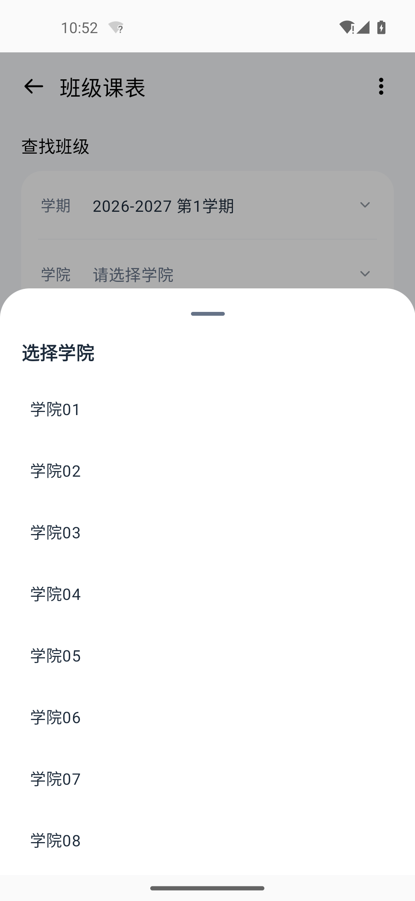
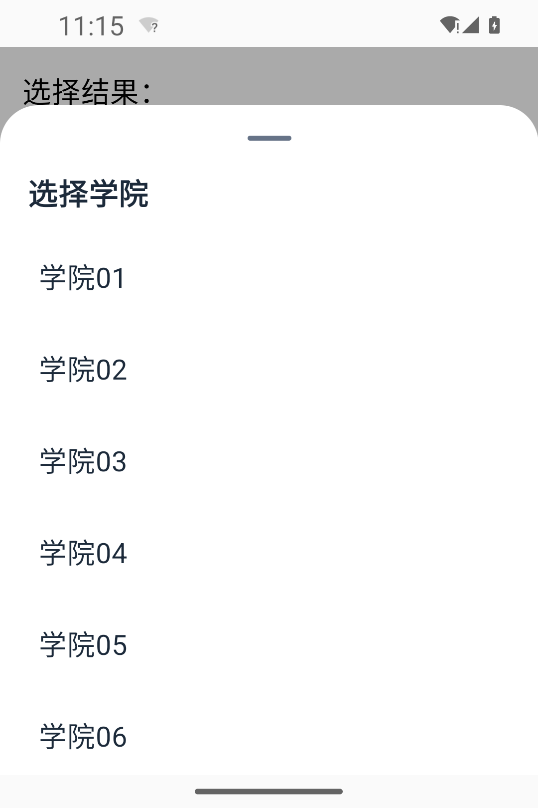

# 可滚动弹窗手势修复

本轮测试包：`2.3 / 120`。

## 修复

学院列表的外部 padding 缩小了可滚动区域。列表边缘的留白会把竖向手势交给整个底部面板；列表首尾的剩余拖动与惯性也可能触发面板动画，使反向滑动发涩或意外收起。

可滚动底部弹窗统一使用 `ScrollSheet`：列表独立处理滚动，弹窗保留原来的白色圆角、顶部短线、遮罩和底部入场动画。点击外部、系统返回键与点选关闭正常工作；顶部短线也可点击关闭。面板内的留白不会触发遮罩关闭。

学院、年级、专业、班级及设置选项把两侧和底部留白移入列表的 `contentPadding`，边缘也能开始滑动。学期选择、课程详情、日历详情和模式说明使用相同的弹窗容器。模式选择保留账号身份校验与关闭后切换的顺序。

普通周次对话框没有外层面板拖动，也进行了长内容的滚动与关闭验证。

## 验证

- 修改前：60 项学院列表滚至末尾，从右侧留白反向滑动会关闭弹窗。
- 修改后：11 个场景、95 项模拟器手势检查通过。覆盖学院、年级、专业、班级、学期、总周数、课程详情、日历详情、周次对话框、小屏学院选择和模式说明。
- 检查包含滚动至末尾、两侧反向滑动、快速反向滑动、回到顶部、首尾额外滑动、点选、点击外部关闭与返回键关闭。
- 常规视口 `1080 × 2340`；小屏 `1080 × 1620`，字体缩放 `1.35`。使用独立 QA 应用与模拟数据，没有真实账号或课程信息。
- 175 项单元测试通过，lint 无错误。
- 测试 APK 的版本、包名、签名与构建资源已复核；签名与 119 一致，QA 活动不在交付 APK 中。
- 从 119 覆盖安装为 120 后正常启动，未出现 AndroidRuntime 崩溃。

## 界面

## 测试产物

- APK：`release/test/sap-test-2.3-120.apk`，3,241,592 字节，约 3.1 MB。
- SHA-256：`7c8a6fa756c4d391d887bdfa0707803baa855ca54b58e99dc66a7d6499fe805b`。
- 使用 R8 混淆与资源压缩，关闭调试。测试包不进入在线升级链路，正式更新日志保持不变。
