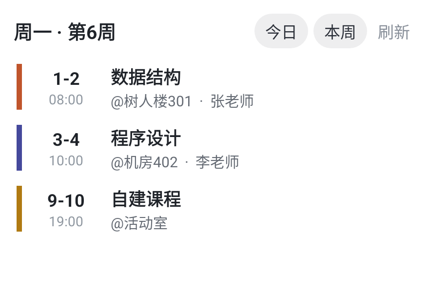
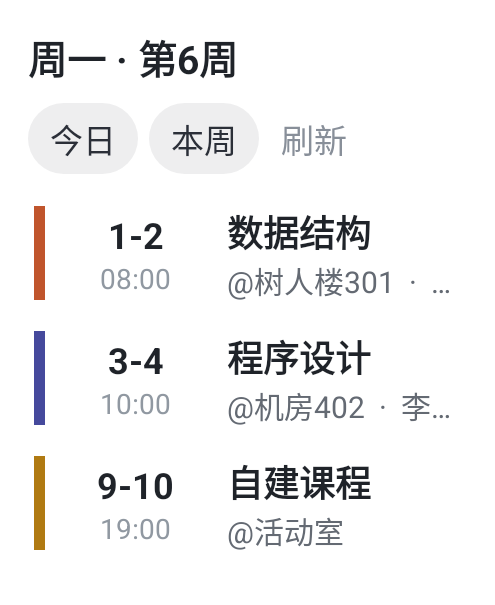

# 桌面课表：明日与周一预告

本轮为测试构建，版本名 `2.3`，构建号 `119`。

## 使用方式

桌面“软协课表”组件保留今日、本周，新增明日入口。标题显示当前视图，右侧提供另外两种视图的切换按钮。每个组件独立保存选择，刷新后保持当前视图。

| 当前日期 | 预告日期 | 入口 / 标题 |
| --- | --- | --- |
| 周一至周四 | 次日 | 明日 |
| 周五、周六、周日 | 下周一 | 周一 |

预告按目标日期重新计算周次，正确处理跨周、单双周、课程的生效周次和自建课程。今日和本周仍可查看周末课程。

普通空课日显示“今日无课”“明日无课”“周一无课”或“本周无课”；仅当前学期后续已无课程时显示“当前学期课程已结束”。未导入课表、未设置开学日期和学期尚未开始分别提示对应操作或状态。

小于 240 dp 的组件将标题和切换按钮分成两行，避免按钮挤掉周次；拖动改变组件尺寸后会重新选择布局。

## 界面示例

以下为 Android 实际 RemoteViews 渲染，使用模拟数据。

## 验证与交付

- 175 项单元测试通过，包含 14 项新增日期与课表预告测试；lint 无错误。
- Android 模拟器 54 项检查通过，覆盖教务、Web、班级、自建课表，以及普通空课日、学期结束、多实例切换、刷新和 180 / 320 dp 尺寸。
- 测试 APK 从 2.3 / 118 覆盖安装为 2.3 / 119，正常启动，未出现 AndroidRuntime 崩溃。
- APK 包名 `edu.csuft.sap`，签名与 118 一致，关闭调试，包含 R8 混淆与资源压缩。QA 活动仅在独立模拟器包中运行，未进入交付 APK。
- APK：`release/test/sap-test-2.3-119.apk`，3,277,544 字节，约 3.1 MB。
- SHA-256：`9a0e35da54f0c66e649d75cbfa920ad3845998bf7afc2886b061a895d5486e0a`。
- 测试包不进入在线升级链路，正式更新日志保持不变。
