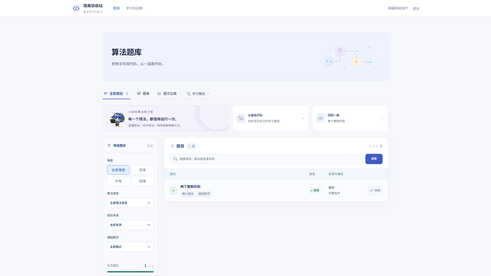
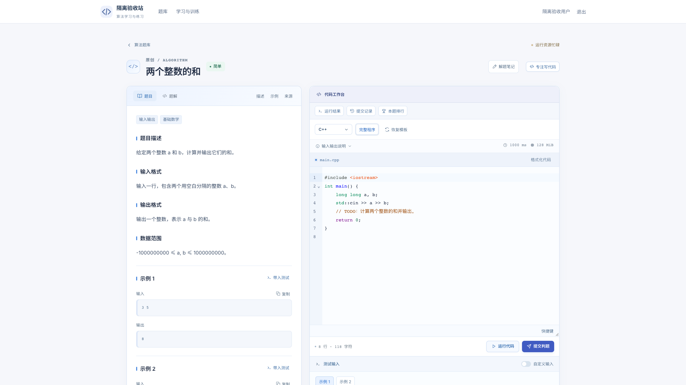
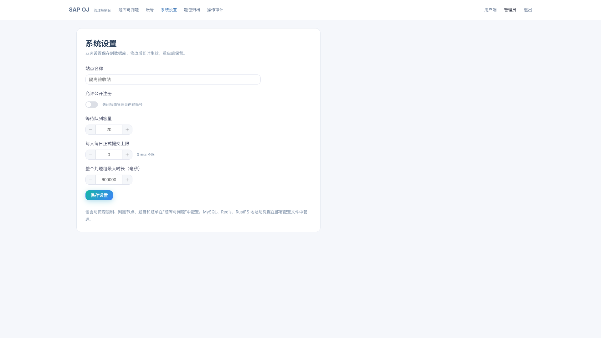
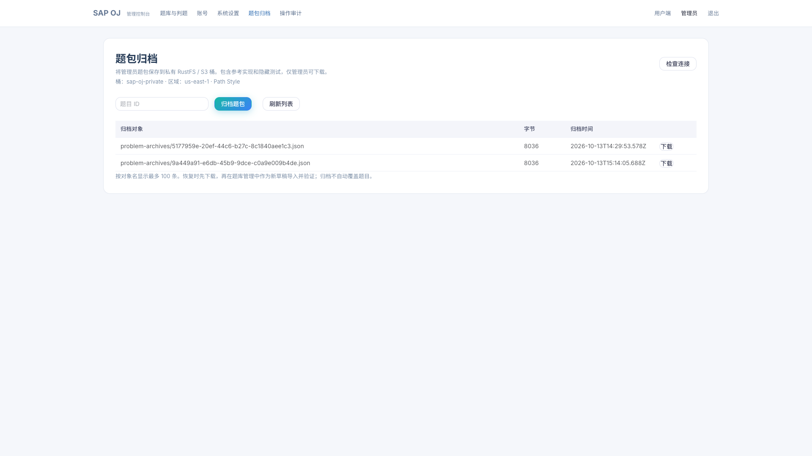

# Lume 独立算法题库

用户端、管理端、Java 后端与五语言判题机已整理为独立项目。合并版只需启动一个应用容器，连接自己的外部 MySQL；不依赖 Redis。首次启动仅创建管理员、语言与必要配置，题目、题单、题解、提交记录均为空，不自动导入题库。

## 镜像

| 镜像 | 用途 |
| --- | --- |
| [`pllysun/lume:1.1.1`](https://hub.docker.com/r/pllysun/lume) | 推荐：两端前端、后端、内置判题机，一个容器 |
| [`pllysun/lume-server:1.1.1`](https://hub.docker.com/r/pllysun/lume-server) | 分离部署：两端前端与后端，连接独立判题节点 |
| [`pllysun/lume-worker:1.1.1`](https://hub.docker.com/r/pllysun/lume-worker) | 分离部署：C、C++、Java、Python、Rust 判题节点 |

三个镜像均为 `linux/amd64`。使用固定版本；`latest` 与当前验收版本一致。MySQL 与可选 RustFS / S3 属于基础服务，不打入应用容器。

## 快速启动

生产判题需要原生 Linux amd64、cgroup v2、Docker Engine，以及能到达的独立 MySQL 数据库。进入源码包或文档部署包根目录：

```bash
python3 tools/init.py
```

编辑生成的私有 `.env`，填写外部 MySQL 的 `DB_URL`、`DB_USER`、`DB_PASSWORD`。数据库需为空并有建表及读写权限；外部连接推荐 TLS，参数按数据库服务配置。生成器中的 `mysql:3306/oj` 仅适用于显式选择的 Compose MySQL，不是外部地址。

```bash
bash tools/run-container.sh
python3 tools/ojctl.py login
python3 tools/ojctl.py health
```

脚本执行一次 `docker run`，启动合并镜像；默认发布 8080 端口，使用 `lume-data` 持久卷。合并版自动在容器自己的 cgroup 命名空间内准备隔离环境，不需要挂载宿主 cgroup，也不用执行宿主准备脚本。完整命令和资源说明见 [单容器部署](docs/SINGLE_CONTAINER.md)。

用户端位于 `http://服务器地址:8080/`，管理端位于 `/admin/`。默认管理员 `admin`，随机密码在本机 `.env`，初始化器不会输出密码。公开注册默认关闭，在管理端“系统设置”启用，或由管理员创建练习账号。公网按部署手册配置 HTTPS。

也可以用默认只有一个应用服务的 Compose：

```bash
docker compose up -d
```

如需显式选择同机基础服务：

```bash
docker compose --profile mysql up -d --wait mysql
docker compose --profile mysql up -d
# RustFS 可选，需先填写 S3 配置
# docker compose --profile mysql --profile rustfs up -d
```

分离版使用 `compose.split.yml`，详见 [部署与运维](docs/DEPLOYMENT.md)。不要同时启动合并版与分离版并让它们写同一个业务库。

## 功能与文档

- 做题：筛选、代码编辑、补全、格式化、样例运行、正式判题、SSE 编译执行过程、提交记录与排名。
- 题解：八节正文，五语言代码标签、高亮、注释与图解，比赛结束后由后端开放。
- 学习：知识路径、练习方向、收藏、错题、计划、笔记、复习、标准库速查与统计。
- 题单：练习与比赛、报名、白名单、时间限制、罚时排名、题目快照与代码公开策略。
- 管理：题面与测试、参考代码、三轮发布验证、题解、语言资源、节点、队列、账号、审计、业务配置与私有归档。
- 判题：受限文件系统、进程与网络隔离、seccomp、cgroup 资源预算、节点鉴权与故障恢复。
- 登录：会话存于 MySQL，重启后保留；退出、账号禁用与密码重置使对应登录状态失效。

| 文档 | 内容 |
| --- | --- |
| [单容器部署](docs/SINGLE_CONTAINER.md) | 一次 docker run、外部数据库、内置判题、资源与重启 |
| [部署与运维](docs/DEPLOYMENT.md) | Compose、独立节点、HTTPS、备份与升级 |
| [RustFS / S3](docs/STORAGE.md) | 配置、可选基础服务与私有题包归档 |
| [AI 操作手册](docs/AI_OPERATIONS.md) | 创建、验证、发布、修订与批量导入 |
| [出题与测试规范](docs/PROBLEM_AUTHORING.md) | JSON、五语言、边界、oracle、差分与错误实现 |
| [核心函数与题面](docs/CORE_MODE.md) | 默认标准库、兼容引包与题面 Markdown |
| [题解规范](docs/SOLUTION_STANDARD.md) | 八节正文、注释代码与安全 SVG |
| [接口说明](docs/API.md) | 认证、题目、提交、SSE、题解和节点 |
| [发布验收](docs/RELEASE.md) | 实际测试、版本与镜像摘要 |
| [来源与许可证](docs/THIRD_PARTY_NOTICES.md) | 上游组件、工具链与素材归属 |
| [AI 仓库规则](AGENTS.md) | 操作前阅读 |

## 界面示例

截图来自隔离验收环境的模拟题目；首次部署仍为空题库。









## AI 创建题目

源码中的一个原创算术示例仅供协议与测试设计参考，不自动导入、不在运行镜像中。先在隔离环境执行：

```bash
python3 tools/generate_example.py --output examples/my-problem --slug original-my-problem --seed 20261014
python3 tools/ojctl.py lint examples/my-problem/pack.json
python3 tools/ojctl.py create examples/my-problem/pack.json
# 用返回的 id 替换占位符
python3 tools/ojctl.py validate <id>
python3 tools/ojctl.py publish <id>
python3 tools/ojctl.py solution <id> examples/my-problem/solution.json
```

示例有五语言代码、41 个可复现用例、题解与覆盖说明。复杂算法另需独立暴力 oracle、差分用例与错误实现；三轮通过不能替代算法正确性推理。

## 开发与构建

需要 JDK 21、Maven、Node.js 22.12+。Vue 3 / Vite 前端；Spring Boot、MyBatis-Plus、JPA、Sa-Token 后端。生产配置只连接 MySQL，H2 仅用于本地测试。

```bash
bash tools/build-local.sh
bash tools/build-images.sh
```

源码 Dockerfile 提供 `server`、`worker`、`bundle` 三个目标，默认目标为合并版。构建不需要先发布任何中间镜像；包含全新依赖安装、前后端测试与构建。详情见部署手册。

```text
standalone-oj/
  user/                 用户端与学习训练
  admin/                管理端与业务设置
  backend/              后端、MySQL 会话与测试
  judge/                沙箱、控制服务与五语言工具链定义
  examples/             手动生成示例，不自动导入
  tools/                初始化、启动、构建、出题与验证工具
  docs/                 部署、存储、AI、接口与规范
  Dockerfile            server / worker / bundle 三个构建目标
  compose.yml           合并版，可选 MySQL / RustFS
  compose.split.yml     分离版与独立判题机
  VERSION               独立镜像版本号
```
